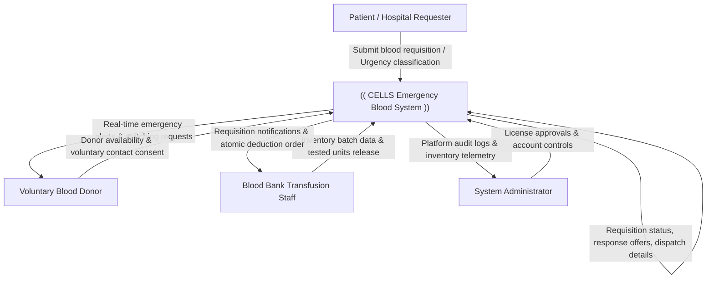
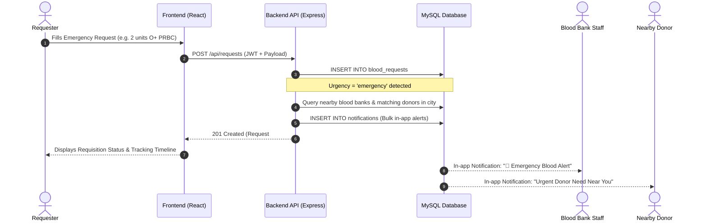
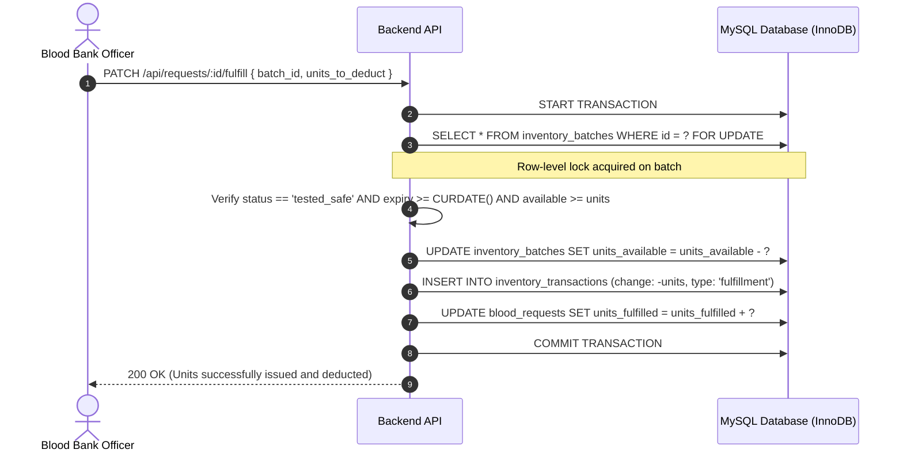

# CELLS — Data Flow & Sequence Diagrams

## 1. Context Diagram (Level 0 DFD)

---

## 2. Sequence Diagram: Emergency Blood Request Dispatch

---

## 3. Sequence Diagram: Atomic Stock Deduction & Requisition Fulfillment

