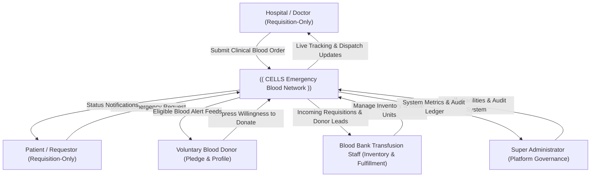
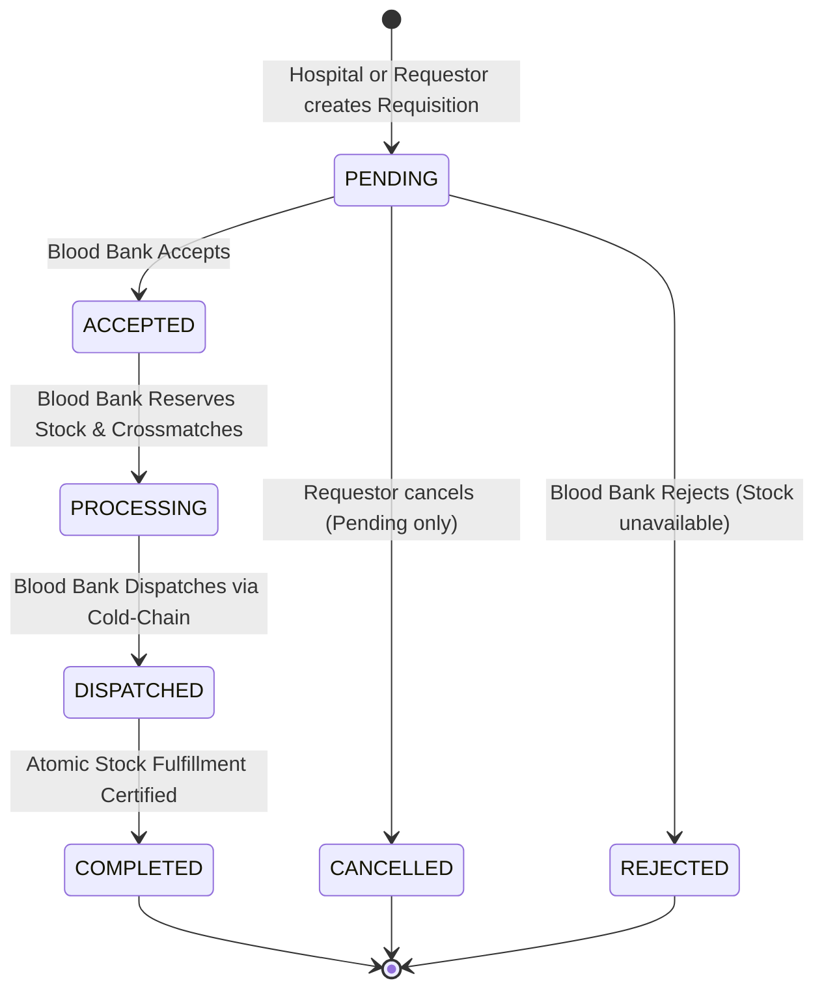
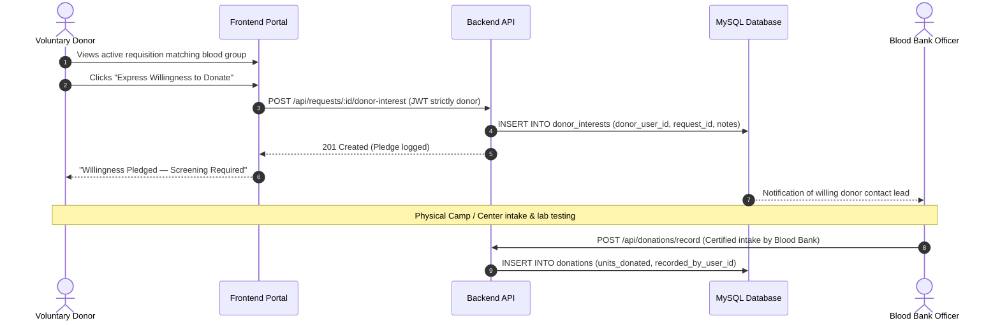
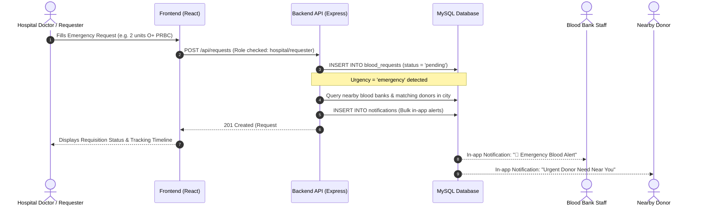
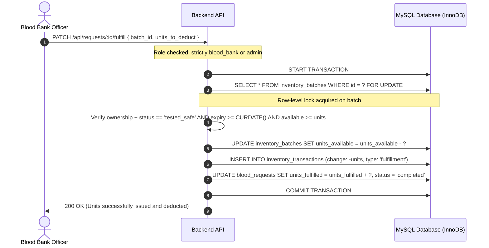

# CELLS — Data Flow, Sequence Diagrams & Operational Lifecycle

## 1. Context Diagram (Level 0 DFD) — 5 Distinct Platform Roles

---

## 2. Requisition Lifecycle & Role State Machine

---

## 3. Separate Voluntary Donor Workflow

---

## 4. Sequence Diagram: Emergency Blood Request Dispatch

---

## 5. Sequence Diagram: Atomic Stock Deduction & Requisition Fulfillment

