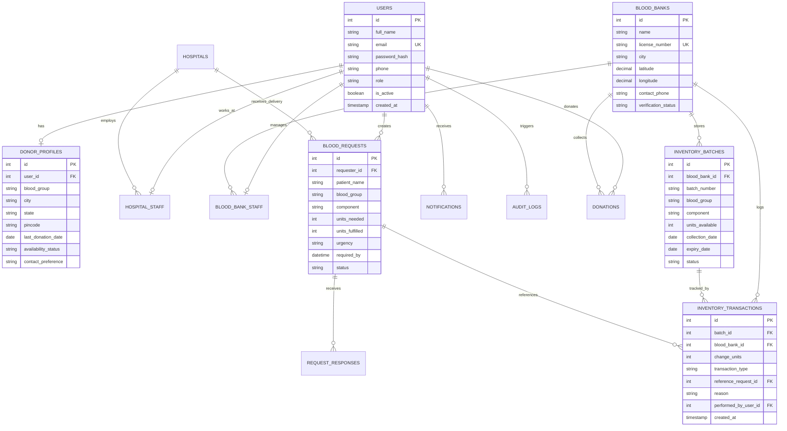

# CELLS — Entity-Relationship Diagram & Data Dictionary

---

## Data Dictionary Highlights

### `users`
- Primary authentication store. Roles: `public_visitor`, `donor`, `requester`, `hospital`, `blood_bank`, `admin`.

### `inventory_batches`
- Tracks stock units by batch with collection date, expiration, and quality status (`quarantined`, `tested_safe`, `rejected`, `expired`, `depleted`).
- Constraint: Unique pair `(blood_bank_id, batch_number)`.

### `inventory_transactions`
- Immutable audit ledger recording every delta (+ or - units), linking batch alterations to emergency requisitions and the responsible staff member.
